<!-- ▶ PANTALLA DE TÍTULO -->

  

  
  
  

 

## 🕹️ Jugador 1

  

Estudio **2º de DAM** y ya he hecho **apps Android para organizaciones reales**. Ahora estoy dando el salto al desarrollo de videojuegos con **Unity y C#**. Me gustan los juegos que te obligan a pensar y las apps que resuelven problemas del día a día.

 

## 🎒 Inventario

  

| Objeto | Rareza | Estado |
|:--|:--|:--|
|  **Kotlin** | `SSR` ★★★★★ | ⚔️ Equipado |
|  **Java** | `SSR` ★★★★★ | ⚔️ Equipado |
|  **SQL** | `SR` ★★★★ | ⚔️ Equipado |
|  **Android Studio** | `SR` ★★★★ | 🛠️ Herramienta principal |
|  **Flutter** | `R` ★★★ | 📈 Subiendo de nivel… |
|  **Git · GitHub** | `SR` ★★★★ | 🛠️ Uso diario |
|  **C#** | `R` ★★★ | 📈 Subiendo de nivel… |
|  **Unity** | `R` ★★★ | 📈 Subiendo de nivel… |

 

## 📜 Diario de misiones

> [!TIP]
> **✅ MISIÓN COMPLETADA · 🎸 App Titanium**
>
> App oficial de una asociación de música rock: próximos eventos, formas de contacto y galería de fotos y vídeos de sus conciertos.
>
> `Kotlin` `Android` · **Botín:** [📂 Código](https://github.com/PerchaCervantina/AppTitanium) · [⬇️ Descargar APK](https://github.com/PerchaCervantina/AppTitanium/raw/feature/admin-accounts/distribucion/titanium.apk)

> [!TIP]
> **✅ MISIÓN COMPLETADA · 🥗 Sensia**
>
> Para personas con alergias, sensibilidades o intolerancias: escaneas el código de barras o la lista de ingredientes y te avisa si el producto lleva algo que no puedes tomar.
>
> `Kotlin` `Android`

> [!IMPORTANT]
> **⏳ MISIÓN PRINCIPAL EN CURSO · ⚔️ HUG**
>
> Mi primer videojuego: un RPG por turnos con sistema gacha, donde cada combate es una decisión estratégica.
>
> `C#` `Unity` · 🚧 En desarrollo

 

## 🏆 Logros desbloqueados

| | Logro | Cómo se consiguió |
|:-:|:--|:--|
| 🥇 | **Primer cliente real** | Publicar una app para una asociación de verdad |
| 🔍 | **Detective de etiquetas** | Hacer que el móvil lea ingredientes por ti |
| 🎮 | **Modo creador** | Empezar a desarrollar un videojuego propio |
| 🤝 | **Party de dos** | Programar con una IA como compañera: ella me ayuda a avanzar y aprender, pero las decisiones y el código final son míos |

🔒 <b>Logro oculto</b> (pulsa para desbloquear)

 

> **⬆️⬆️⬇️⬇️⬅️➡️⬅️➡️🅱️🅰️ · Explorador incansable**
>
> Has leído este perfil hasta aquí. Eso ya dice bastante de ti. ¿Hablamos?

 

## 📊 Estadísticas de partida

  
  

  

🐍 Mis contribuciones, convertidas en un nivel de Snake

  

 

## 💾 Punto de guardado

  <i>Es peligroso ir solo. Llévate esto:</i>
    
  
  

  

  

